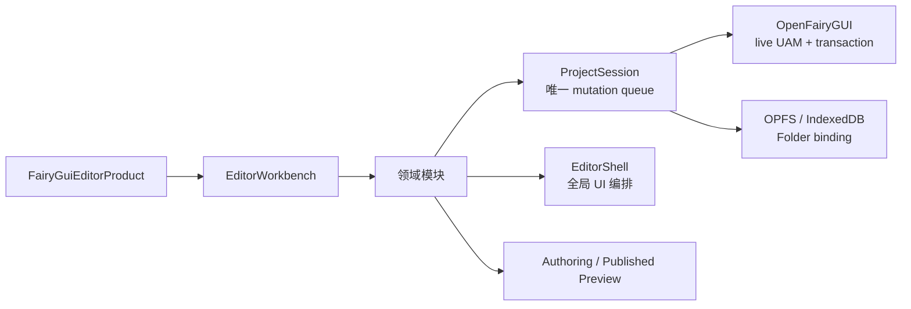

# FairyGUI Editor Online

> 在浏览器中导入、编辑、保存、发布和预览 FairyGUI 工程。

[在线体验](https://editor.fairygui.dev/) · [架构文档](./docs/editor-workbench-architecture.md) · [项目文档](./docs/README.md) · [OpenFairyGUI](https://github.com/OpenFairyGUI/OpenFairyGUI) · [OpenFairyGUI 文档](https://fairygui.dev/)

> [!WARNING]
> **这是一个实验性项目，不是 FairyGUI 官方产品，也尚未承诺生产级稳定性。** 当前仓库用于探索 OpenFairyGUI 在真实浏览器编辑器中的工程读写、事务、发布和模块化边界。请在导入或绑定本地目录前保留独立备份，不要把浏览器工作区作为工程的唯一副本。

FairyGUI Editor Online 使用 [OpenFairyGUI](https://github.com/OpenFairyGUI/OpenFairyGUI) 读取和修改 `.fairy` 工程，以冻结的 LayaAir 3.3.10 与 FairyGUI Web 运行时提供 Authoring Canvas 和已发布 runtime 预览。项目采用 local-first 设计：工程默认保存在浏览器工作区，只有用户明确授权后才会写回本地目录。

## 在线体验

### [打开 FairyGUI Editor Online →](https://editor.fairygui.dev/)

- 推荐使用最新版 Chrome 或 Edge，以获得 File System Access API、OPFS 和目录写回能力。
- 不支持目录句柄的浏览器仍可使用浏览器工作区，并通过 ZIP 导入和导出工程。
- 在线版本会持续随实验进展更新；行为和数据格式边界可能变化，重要工程请先备份。

## 项目定位

项目希望回答一个具体问题：**OpenFairyGUI 的浏览器能力，能否支撑一个可持续演进、可模块化复用的真实 FairyGUI 编辑器？**

| 方向 | 当前原则 |
| --- | --- |
| 浏览器优先 | 工程导入、编辑、保存、发布和预览不依赖 LayaAir IDE 或本地 HTTP bridge |
| 本地优先 | 数据保存在 OPFS / IndexedDB；Folder 写回必须由用户授权并经过冲突检查 |
| 格式兼容 | 标准 `.fairy` 工程和 OpenFairyGUI UAM 是事实来源，runtime object 只做派生显示 |
| 可靠编辑 | 修改统一经过 typed transaction、preflight、Undo/Redo、checkpoint 和保存后验 |
| 模块化复用 | 产品显式组合 Session、Document、Explorer、Inspector、Timeline、Transfer 等能力 |
| 受控扩展 | 浏览器插件使用权限清单、sandboxed iframe 和 Worker，不暴露 DOM、OPFS handle 或 live UAM |

这不是桌面 FairyGUI Editor 的 Web 套壳，也不是 OpenFairyGUI 的演示页面。它会参考桌面编辑器的成熟交互，但只实现已经能够通过 OpenFairyGUI UAM、事务和浏览器存储安全闭环的能力。

## 核心能力

### 工程与工作区

- 默认显示原版 FairyGUI 欢迎首页；创建或打开本地项目时选择目录并授予读写权限，最近项目支持刷新后重新授权。
- 首页打开本地项目使用独立浏览器工作区；创建项目使用空目录，生成标准 LayaAir `.fairy` 工程。
- 从本地 Folder 或 ZIP 导入 FairyGUI 工程，并在写入前预览来源、工程路径和文件数量。
- 使用 OPFS，缺失时降级 IndexedDB；支持多工作区、刷新恢复和 Web Locks 并发保护。
- 保存后重新读取工程进行后验验证；Folder 写回使用 SHA-256 基线阻断外部冲突。
- 无可写目录句柄时，可导出能够被同一导入器重新打开的标准 ZIP。

### 编辑与资源

- 浏览 package、component、resource、Hierarchy、Favorites、Search 和 References。
- 多文档标签、Group isolation、组件引用导航和逐文档选区恢复。
- 画布选择、框选、拖动、缩放、旋转、Pivot、吸附、缩放和平移。
- 多选 Inspector、对齐、等尺寸、分布、表格排列、复制粘贴、层级调整和跨组件 reparent。
- Controller、Transition、Timeline、relation、gear、资源与项目/发布设置编辑。

### 历史、发布与预览

- 所有工程写入进入统一 Session 队列，并以 forward/inverse operation group 提供 Undo/Redo。
- Save 只移动 checkpoint，不清空 Undo；未保存修改和未发布 runtime 分别跟踪。
- Authoring Preview 由当前 UAM 快照投影，支持编辑交互但不作为工程事实来源。
- Published Test 加载已保存并发布的 `.fairygui-runtime`，验证设备适配、Controller、Transition、Popup 和 Tooltips。

### 模块与插件

- `EditorWorkbench` 管理模块顺序、服务所有权、依赖保护、激活回滚和逆序清理。
- 核心能力拆分为 Session、Preview、Document、Workspace、Explorer、Inspector、Dialogs、Display List、Timeline 和 Resource Authoring。
- Fairy package transfer、Workspace transfer、Runtime Publish、Browser Plugins 和 Resource Health 作为产品能力组合。

## 架构一览



当前核心产品按显式顺序组合模块，不使用通用 EventBus、Service Locator 或自动依赖解析。`EditorShell` 继续负责全局键盘/焦点仲裁、布局、Published Test 和仍需跨多个领域的 UI 编排；领域状态与事务逐步由具体模块拥有。

完整模块清单、依赖关系、数据流、热拔插等级和下游复用方式见 [Editor Workbench 模块架构](./docs/editor-workbench-architecture.md)。

## 技术栈

| 类别 | 框架或库 | 用途 |
| --- | --- | --- |
| 开发语言 | TypeScript 5.9，严格模式 | 编辑器、命令、存储和浏览器交互 |
| 构建工具 | Vite 8 | 开发服务器、TypeScript 编译和 Web 构建 |
| 编辑模型 | OpenFairyGUI 0.2.4 | `.fairy` 工程读写、UAM、transaction、save 和 browser publish |
| 渲染引擎 | LayaAir 3.3.10 Web runtime | Stage、渲染和输入事件；版本冻结，不依赖 LayaAir IDE |
| UI runtime | FairyGUI-Layabox | 编辑器界面、Authoring Canvas 和 runtime component |
| ZIP | fflate 0.8.3 | 浏览器内 ZIP 导入与导出 |
| 浏览器能力 | OPFS、IndexedDB、File System Access API、Web Workers、Web Locks | 本地存储、目录写回、插件隔离和并发保护 |

项目不使用 React、Vue 等 DOM UI 框架。编辑器界面由 FairyGUI 组件构建，Vite 直接编译 `src/Main.ts` 及其 TypeScript 模块。

## 本地运行

需要 Node.js `>=22.18.0`。

```powershell
git clone --recurse-submodules https://github.com/OpenFairyGUI/FairyGUI-Editor-Online.git
cd FairyGUI-Editor-Online
npm install
npm run dev
```

已有 checkout 可补齐 submodule：

```powershell
git submodule update --init
```

开发服务器默认监听 `http://127.0.0.1:5173`。

## 构建与验证

日常检查：

```powershell
npm run typecheck
npm run build
npm run preview
```

维护者完整回归：

```powershell
npm run verify
```

回归脚本位于 `scripts/internal/`。完整验证会重新生成发布所需的快照和 runtime 文件，并把报告写入已忽略的 `verification/reports/`。

提交依赖生成的快照和 runtime 文件前执行：

```powershell
npm run generate
```

发布编辑器自身的 `Basic` / `Builder` UI package：

```powershell
npm run publish:editor-ui
```

该命令从官方 UI submodule 的 `vendor/FairyGUI-Editor/ui` 发布到 `assets/resources/ui/`，不会修改 submodule 源文件。

默认测试工程是 `samples/FairyGUI-layabox/demo/UIProject/FairyGUI-layabox-demo.fairy`；可以通过 `FAIRYGUI_AUTHORING_PROJECT` 指向其他 `.fairy` 工程。

## 目录结构

| 路径 | 说明 |
| --- | --- |
| `src/editor/product/` | 核心产品与完整产品的显式模块组合 |
| `src/editor/workbench/` | Workbench 生命周期、服务注册和最小 host contract |
| `src/editor/modules/` | Session、Document、Explorer、Inspector、Timeline、Transfer 等模块 |
| `src/editor/commands/` | transaction preparation、preflight、命令和历史支持 |
| `src/editor/services/` | OpenFairyGUI live session、浏览器存储、导入、保存和发布服务 |
| `src/editor/runtime/` | Authoring Preview、Published Test、插件 host 和桌面交互逻辑 |
| `src/editor/ui/`、`src/editor/dialogs/` | FairyGUI 面板 Controller、呈现和对话框 |
| `assets/` | Vite 静态输入、冻结 runtime 和编辑器 UI package |
| `vendor/FairyGUI-Editor/` | 官方 FairyGUI Editor UI submodule |
| `samples/FairyGUI-layabox/` | 官方 FairyGUI-Layabox submodule 与默认测试工程 |
| `scripts/` | 资源生成、发布准备和内部回归工具 |
| `docs/` | 架构、工作流、OpenFairyGUI 集成和插件文档 |

## 数据安全边界

- ZIP / Folder 导入先写入浏览器工作区，不会在确认前修改原目录。
- Folder 写回只覆盖当前工作区已跟踪的目标，不删除用户目录中的额外文件。
- 检测到 changed、missing 或 externally-created target 时停止写回并保留浏览器工作区。
- 写回中途失败会尝试逆序恢复已经写入的文件。
- UAM 无法保真写回时拒绝 Save，不静默覆盖源工程。
- 实验阶段仍可能存在未覆盖的格式或浏览器差异；请始终保留独立备份。

## 文档导航

| 文档 | 内容 |
| --- | --- |
| [系统架构](./docs/architecture.md) | Web 启动、UAM、浏览器存储、发布和 runtime 边界 |
| [Editor Workbench 模块架构](./docs/editor-workbench-architecture.md) | 当前模块、服务依赖、生命周期、数据流和下游复用 |
| [编辑工作流](./docs/editor-workflows.md) | 工程生命周期、画布、Inspector、历史和预览行为 |
| [OpenFairyGUI 集成](./docs/openfairygui-integration.md) | package、session、transaction、save 和升级约束 |
| [浏览器插件](./docs/browser-plugins.md) | manifest、权限、沙箱和第一版写入边界 |

## 相关项目与链接

- [在线体验](https://editor.fairygui.dev/)
- [OpenFairyGUI GitHub](https://github.com/OpenFairyGUI/OpenFairyGUI)
- [OpenFairyGUI 文档](https://fairygui.dev/)
- [FairyGUI 官网](https://fairygui.com/)
- [FairyGUI Editor UI](https://github.com/fairygui/FairyGUI-Editor)
- [FairyGUI-Layabox](https://github.com/fairygui/FairyGUI-layabox)

## 项目来源、商标与许可证

本项目最初基于 LayaAir Editor 生成的工程结构建立，当前 Web 开发与构建使用 Vite，不依赖 LayaAir Editor；浏览器运行时继续使用仓库中冻结的 LayaAir Web runtime。

编辑器 UI 工程通过 `vendor/FairyGUI-Editor/` 关联官方 FairyGUI Editor 仓库。默认示例工程通过 `samples/FairyGUI-layabox/` 关联官方 FairyGUI-Layabox 仓库；两个 submodule 均保持上游来源，不在本仓库中修改。

本项目使用的编辑器 UI 工程已取得 FairyGUI 官方口头授权，但该授权不构成通用商标许可，也不自动延伸至 fork、衍生项目或其他第三方。软件许可证不授予 FairyGUI 名称、Logo 或其他品牌标识的使用权；具体边界见 [商标与品牌使用政策](./TRADEMARKS.md)。

本项目原创代码使用 [MIT License](./LICENSE)。LayaAir、FairyGUI、OpenFairyGUI 及其他第三方代码和资源保留各自版权与许可，详见 [THIRD_PARTY_NOTICES.md](./THIRD_PARTY_NOTICES.md)。
