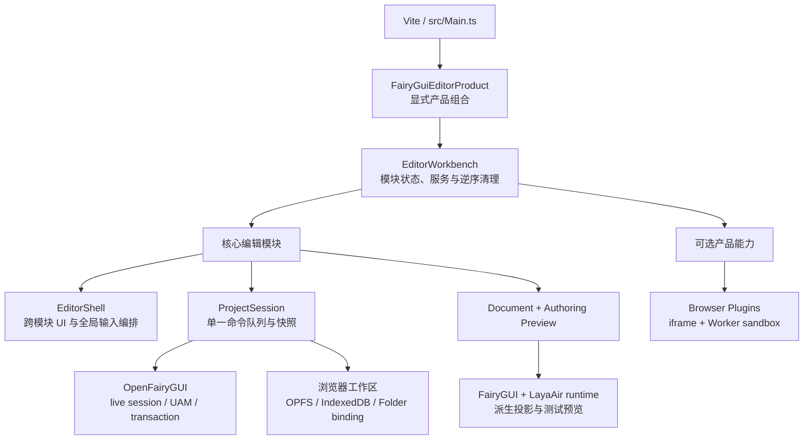
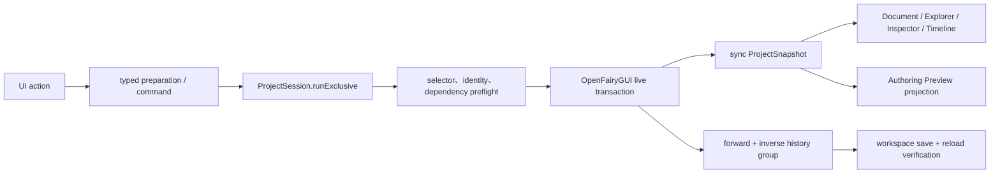

# Editor Workbench 模块架构

> 本文描述当前仓库已经落地的模块架构。实现入口以 `src/editor/product/FairyGuiEditorCoreProduct.ts`、`src/editor/product/FairyGuiEditorProduct.ts` 和 `src/editor/workbench/EditorWorkbench.ts` 为准。

FairyGUI Editor Online 既是一个实验性的浏览器编辑器，也是同技术栈编辑器产品的参考实现。模块化的目标是让产品按能力组合编辑器，同时保留 OpenFairyGUI UAM、事务、历史、浏览器工作区和插件沙箱的安全边界；它不是把整个应用包装成一个通用 SDK。

## 1. 设计目标

- **显式组合**：产品入口直接声明模块及启动顺序，不使用自动扫描或隐式依赖注入。
- **单一事实来源**：工程事实来自 OpenFairyGUI 的 live UAM；快照、Inspector、Hierarchy 和画布都是派生视图。
- **单一写入队列**：所有工程修改最终进入 `EditorProjectSession.runExclusive()`，避免并发命令、保存和工作区切换互相穿插。
- **明确所有权**：listener、弹窗、Blob URL、runtime package、异步任务和服务都由创建它们的模块释放。
- **可裁剪产品**：导入、导出、发布、插件和资源健康等能力可以按产品方向选择，不反向塞回 `EditorShell`。
- **可信模块与外部插件分层**：内部模块运行在应用上下文；外部插件仍受 iframe、Worker 和显式权限限制。

当前阶段不追求：

- 为每个 Controller 再增加一层接口或适配器；
- 引入通用 EventBus、Service Locator 或依赖解析器；
- 仅为减少文件行数而拆散画布 pointer FSM；
- 发布独立的 `@openfairygui/editor-*` SDK 或 export 构建。

## 2. 总体分层



各层职责如下：

| 层 | 主要职责 | 不应拥有的内容 |
| --- | --- | --- |
| 产品组合 | 选择模块、确定顺序、区分核心与产品能力 | 工程写入逻辑 |
| Workbench | 模块状态、服务所有权、依赖记录、激活回滚、逆序清理 | 业务事件总线、UAM 数据 |
| 核心模块 | Session、文档、Explorer、Inspector、画布、资源、Timeline 等领域能力 | 绕过 Session 的直接写入 |
| `EditorShell` | 全局键盘与焦点仲裁、布局、菜单和仍需跨多个领域的 UI 编排 | 重新实现已下沉模块的领域状态 |
| OpenFairyGUI / 存储 | 工程读取、UAM、事务、保存、发布、浏览器文件系统 | 编辑器临时 UI 状态 |
| Runtime Preview | Authoring 投影、已发布 runtime 测试和资源包生命周期 | 反向生成工程事实 |

## 3. Workbench 生命周期

模块使用一个最小契约：

```ts
interface EditorModule<THost> {
    id: string;
    hotReloadable?: boolean;
    activate(
        context: EditorModuleContext<THost>,
    ): void | (() => void | Promise<void>) | Promise<void | (() => void | Promise<void>)>;
}
```

`EditorWorkbench` 提供四个关键机制：

1. `provideService()` 记录服务及其模块所有者；模块停用时自动移除。
2. `requireService()` 解析具体服务并记录真实模块依赖；仍有活动消费者时拒绝拔出提供者。
3. `onDeactivate()` 和 `activate()` 返回的 disposer 按 LIFO 顺序执行。
4. `start()`、`activate()`、`deactivate()`、`reload()`、`attach()`、`detach()` 和 `dispose()` 共用 Workbench 自身的串行状态队列。

产品入口按数组顺序安装模块。启动中任一模块失败时，已经激活的模块会逆序回滚；运行期 `attach()` 失败也不会留下半安装记录。

## 4. 当前核心模块

`createFairyGuiEditorCoreModules()` 当前按以下顺序装配核心能力。核心模块都声明为 `hotReloadable: false`，因为它们拥有全局 FairyGUI 视图、live session、共享交互状态或被 `EditorShell` 持续消费。

| 顺序 | 模块 / 服务 | 主要所有权 | 直接依赖 |
| ---: | --- | --- | --- |
| 1 | `fairygui.shell-chrome` | `Builder/MainView` 的面板引用、action/menu/layout/status contribution | Workbench host |
| 2 | `fairygui.project-session` | `BrowserProjectStorage`、live bridge、命令历史、快照、发布状态和唯一 mutation queue | 无 |
| 3 | `fairygui.authoring-preview` | `RuntimePreviewController`、runtime package loader、Blob URL 与画布运行时资源 | Chrome、Session |
| 4 | `fairygui.document-authoring` | 多文档标签、活动文档、选区、GroupPath、逐文档画布视图与 Authoring Preview 协调 | Chrome、Session、Preview |
| 5 | `fairygui.workspace-lifecycle` | 初始化、保存、新建、切换、关闭、导入、重新授权、外部变化检查和故障隔离 | Chrome、Session、Document |
| 6 | `fairygui.project-explorer` | Library、Favorites、Search、References、Hierarchy 的读模型、呈现和资源预览 | Chrome、Session、Document |
| 7 | `fairygui.inspector` | 单选/多选 Inspector 呈现和经 Session 提交的属性编辑 | Chrome、Session、Document、Explorer |
| 8 | `fairygui.authoring-dialogs` | 组件、项目、资源等 Authoring 对话框及相关 action | Chrome、Session、Document、Explorer |
| 9 | `fairygui.display-list-authoring` | 放置、拖放、重命名、锁定、复制粘贴、替换和显示列表事务 | Chrome、Session、Document、Explorer、Dialogs |
| 10 | `fairygui.timeline` | Controller / Transition / Timeline 面板与 typed authoring | Chrome、Session、Document、Dialogs |
| 11 | `fairygui.resource-authoring` | 资源创建、导入、编辑、删除及资源相关 action | Chrome、Session、Document、Explorer、Dialogs |
| 12 | `fairygui.editor-shell` | 剩余跨模块 UI 编排、布局、全局输入/焦点仲裁、Published Test 和菜单状态 | 上述具体服务 |

`EditorShell` 仍然存在是有意的：全局快捷键、Timeline/Hierarchy/Canvas 焦点优先级、Desktop layout 和 Published Test 等行为需要一个明确的组合层。后续提取应以责任和生命周期闭环为依据，而不是以文件行数为依据。

## 5. 当前产品能力模块

`createFairyGuiEditorProductModules()` 在核心模块之后追加下列能力。没有显式写出 `hotReloadable: false` 的模块使用 Workbench 默认的可重载策略，但前提仍是 disposer 能完整撤销 action、弹窗和在途任务。

| 模块 | 默认生命周期 | 用途 |
| --- | --- | --- |
| `fairygui.fairy-package-import` | Workbench 级 | 导入 Fairy package 或其中资源；等待内部队列结束后清理 |
| `fairygui.fairy-package-export` | 可停用/重载 | 导出当前 package 或资源 |
| `fairygui.workspace-import` | 可停用/重载 | 授权目录选择、预览和工作区导入对话框 |
| `fairygui.runtime-publish` | 可停用/重载 | 保存检查、Publish Settings、runtime 发布和在途任务回收 |
| `fairygui.browser-plugins` | 可停用/重载 | 外部插件 host、权限、菜单/面板 contribution 和沙箱生命周期 |
| `fairygui.resource-health` | 可停用/重载 | 资源重复、未使用和名称冲突审计入口 |

因此，下游若只想复用编辑能力而不需要资源包导出，可以在产品组合中省略 `fairygui.fairy-package-export`，不需要修改核心 Session、Document 或 Shell 的内部实现。

## 6. 工程事实与数据流



必须保持以下不变量：

- UAM working project 是工程事实；`ProjectSnapshot` 是面向 UI 的只读投影。
- Runtime object、缩略图和 Published Test 不能反向生成 transaction。
- 在 `runExclusive()` 内只调用 `*Now` 或底层 apply 方法，禁止再次进入 `runExclusive()` 形成自锁。
- 高风险 preparation 在用户交互开始时捕获 session identity；进入队列后再次验证，防止跨工作区或跨 revision 写错对象。
- 成功提交由 Session 统一同步快照；同一路径不能再手工重复 render。
- 标签页、GroupPath、布局、快捷键、画布 zoom/pan 和 TestView 设备状态属于 UI state，不进入 UAM、history 或 dirty checkpoint。

## 7. 工作区与故障隔离

`EditorWorkspaceLifecycle` 是工作区 UI 编排入口，底层复用 `WorkspaceLifecycleController` 和 Session 的唯一队列。切换、关闭、导入失败时必须同步处理 live session、快照、文档、runtime package 和 Published Test，不能继续展示旧工程。

导入发生不可恢复的 rollback failure 时，当前工作区进入 fail-closed quarantine：

- 隔离标记按 workspace 独立保存；
- localStorage 与独立 IndexedDB 任一可验证写入成功即可建立持久标记；
- 读取不确定时拒绝自动连接；
- 只有重新导入并通过 live-session 验证后才能清除标记；
- 无法建立持久隔离时，当前页面也会清空 Session/Document 并明确禁止刷新后继续使用损坏工作区。

## 8. 预览边界

项目包含两种不同预览：

- **Authoring Preview**：由当前 UAM 快照生成可交互投影，支持选择、拖动、缩放、旋转、Pivot、路径点和画布视图；pointer move 只更新临时投影，pointer up 才提交 transaction。
- **Published Test**：加载已保存并发布的 `.fairygui-runtime`，用于验证真实 runtime、设备适配、Controller、Transition、Popup 和 Tooltips。

`AuthoringRuntimePackageLoader` 负责 package lease、Blob URL 和 bundle revision。工作区切换、导入、Publish 和 dispose 都必须使旧 runtime package 失效。

## 9. 下游复用方式

同技术栈的新编辑器产品建议按以下顺序复用：

1. 复用 `EditorWorkbench` 生命周期和具体服务注册方式。
2. 从 `createFairyGuiEditorCoreModules()` 选择真正需要的领域模块，或创建新的显式产品组合。
3. 将导入、导出、发布、插件、资源健康等能力作为叶子模块增删。
4. 若 UI root 不再是 `Builder/MainView`，提供新的 Chrome/host 模块，而不是让领域模块直接查找全局视图。
5. 只有第二个真实产品需要跨仓库版本同步时，才考虑把稳定模块发布为独立包。

当前仓库 `private: true`，没有公共 export 构建。这里的“复用”首先指架构与源码级组合，不承诺稳定的跨仓库 API。

## 10. 新模块约束

1. 模块 ID 使用小写命名空间，例如 `maker.agent-observation`。
2. 优先依赖具体领域服务；不要新建万能 context、EventBus 或 Service Locator。
3. listener、action、弹窗、item pool、stage drag、计时器、Worker、Blob URL 和 pending task 必须有对称清理。
4. 可热重载模块的 disposer 必须先拒绝新操作，再注销入口，最后等待在途任务结束。
5. 模块不得直接写 UAM；写入仍走 Session、typed preparation、preflight、history 和 Save checkpoint。
6. 画布的 drag/marquee/resize/rotate/pivot/graphPoint/pan 互斥状态必须整体维护，不按 gesture 随意拆散。
7. 全局键盘监听保持单点路由，避免多个模块争抢 Escape、Delete、Space 或方向键优先级。

## 11. 验证

架构相关基础检查：

```powershell
npm run typecheck
node scripts/internal/verify-editor-workbench.mjs
node scripts/internal/verify-phase10-ui-interactions.mjs
```

`verify-editor-workbench.mjs` 覆盖模块顺序、服务依赖、活动消费者保护、activate/deactivate/reload、attach/detach、LIFO cleanup 和失败回滚。完整回归使用：

```powershell
npm run verify
```

静态验证不能替代浏览器验收。涉及工作区、画布、Publish、TestView、弹窗或热重载的变更，还应验证真实交互、刷新恢复、dirty/history、在途任务清理以及控制台 error/warning。
